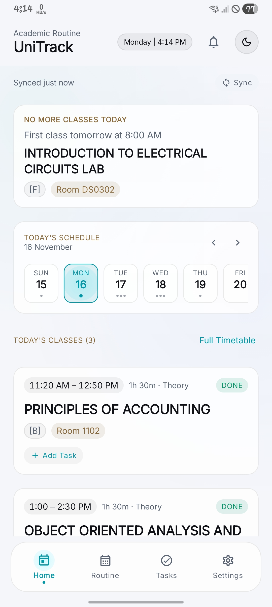
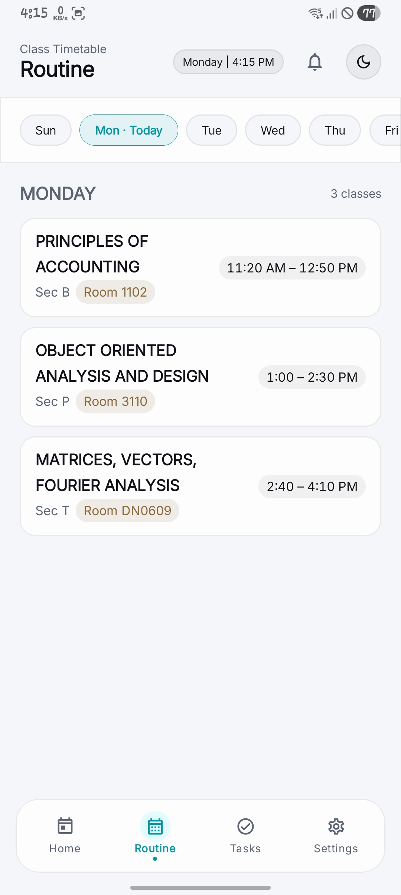
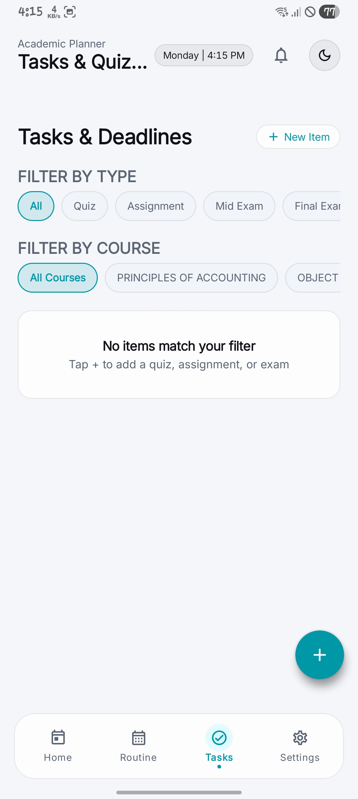
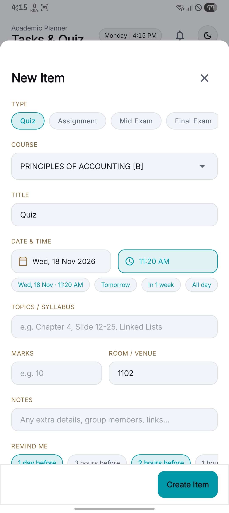
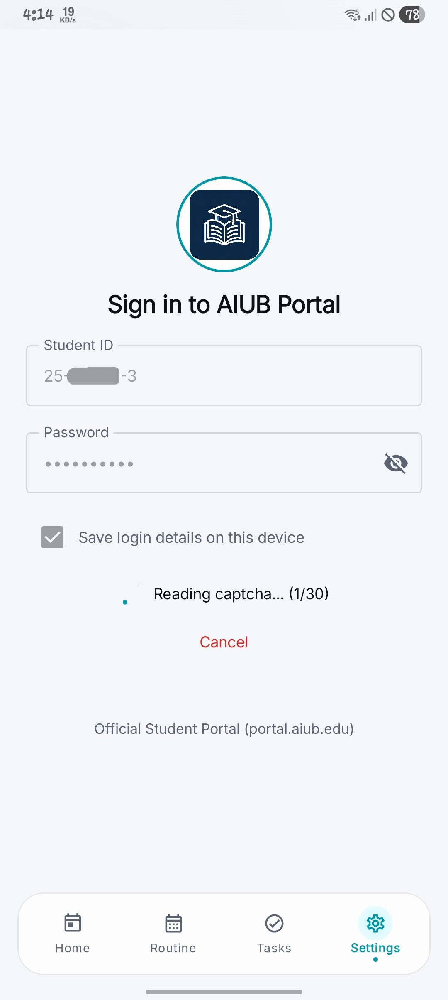
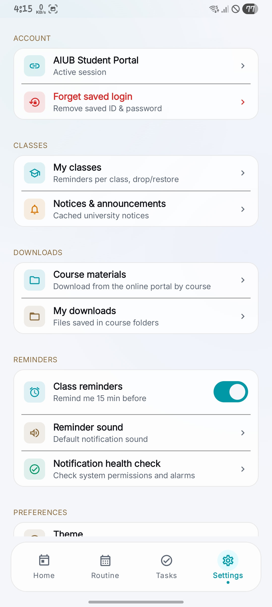

<div align="center">

<!-- logo.png রিপোর ROOT-এ রাখলে নিচের লাইনটির কমেন্ট তুলে দিন -->
<!--  -->

# 🎓 UniTrack

### Offline-first academic assistant for AIUB students

Your class routine, quizzes, assignments, exams and course files — synced from the AIUB student portal and available **even without internet**.

[](#-requirements)
[](https://kotlinlang.org/)
[](#-features)
[](#)
[](LICENSE)

**[⬇️ Download APK](https://github.com/showaib01/UniTracker/releases/latest)** ·
**[🚀 Run Locally](#-run-locally-in-android-studio)** ·
**[✨ Features](#-features)** ·
**[🐞 Report a Bug](https://github.com/showaib01/UniTracker/issues)**

</div>

> ⚠️ **Unofficial student project.** UniTrack is not affiliated with or endorsed by American International University-Bangladesh (AIUB). All data comes directly from `portal.aiub.edu` using your own login.

---

## ✨ Features

### 📅 Today dashboard
- Live status card: **LIVE NOW** (with minutes remaining and end time), **NEXT CLASS TODAY**, or **NO MORE CLASSES TODAY** with tomorrow's first class
- **ALL CAUGHT UP** screen when there are no classes today or tomorrow
- Week strip (Sun–Fri) to jump between days and see that day's schedule
- Today's classes with time, duration, type (Theory / Lab), section, room and **DONE / UPCOMING** status
- **+ Add Task** shortcut on every class card
- **Due soon** list of upcoming deadlines
- Last-synced indicator and a one-tap **Sync** button

### 🗓️ Routine
- Day-by-day class timetable (Sun–Fri) with course name, section, time and room
- **Full Timetable** view of the whole week

### ✅ Tasks & deadlines
- Item types: **Quiz, Assignment, Mid Exam, Final Exam, Lab Report, Project, Presentation, Other**
- Filter by type and by course
- Create items with course, title, date & time (quick chips: *Tomorrow*, *In 1 week*, *All day*), topics/syllabus, marks, room/venue and notes
- **Remind me** presets: 1 day, 3 hours, 2 hours or 1 hour before
- Status tracking (To-do / Done / Missed) and score obtained
- Upcoming and Past sections per course
- **Auto-save** of a draft if the New Item sheet is closed accidentally

### 📘 Course page
- Section, upcoming and past items, class times this week
- **Mute / unmute** reminders for a single course
- **Drop / restore** a course

### 🔐 AIUB portal login
- Native sign-in screen with optional **Save login details on this device**
- Saved credentials are stored **encrypted** (Android Keystore + EncryptedSharedPreferences)
- **Automatic captcha solver** — on-device Tesseract OCR with up to 30 retry attempts, plus manual captcha entry with refresh as a fallback
- Full **AIUB Portal** opens inside the app (notices, registration, exam schedule and everything else the website offers)
- **Forget saved login** to remove your ID and password

### 🔄 Sync (offline-first)
- Routine is saved in a local Room database, so it works without internet
- Background sync every **12 hours**, plus manual **Sync** anytime
- Cached **university notices** with read / unread status

### ⏰ Smart reminders
- Class reminder before every class (default **15 minutes**, adjustable)
- Task reminders for quizzes, assignments and exams
- Choose your own **reminder sound**
- Exact alarms are rescheduled automatically after reboot, app update, time or timezone change
- **Notification health check**: verifies notification permission, channel importance, exact alarm permission and unrestricted battery, shows OEM background-limit help (Xiaomi, Oppo, Vivo, Samsung), lets you send a **test notification now or in 1 minute**, and lists your next scheduled reminders

### 📥 Course materials & downloads
- Download course materials from the online portal, organized **by course**
- **My downloads** — files grouped in per-course folders with file count and size, open or delete
- Files are saved in the app's `Documents/UniTrack/Courses/` folder

### 🎨 Preferences
- Theme: **System default, Light or Dark**
- Bottom navigation: Home · Routine · Tasks · Settings
- **My classes** manager and **About** page (v1.2.0)

---

## 📸 Screenshots

<!-- screenshots/ ফোল্ডারে ছবি রাখুন (নাম নিচের মতো দিলে লিংক কাজ করবে) -->

<div align="center">

| Today | Routine | Tasks |
|:---:|:---:|:---:|
|  |  |  |

| New Item | Login & captcha | Settings |
|:---:|:---:|:---:|
|  |  |  |

</div>

---

## 🚀 Run Locally in Android Studio


### 📋 Requirements
- [Android Studio](https://developer.android.com/studio) (latest stable — the project uses Android Gradle Plugin 9.4)
- **JDK 17** (Android Studio's bundled JDK works; Gradle can also download it automatically)
- Android SDK **API 36**
- Device or emulator with **Android 7.0 (API 24)** or newer
- Internet connection for the first Gradle sync

### 1️⃣ Get the project

**Option A — Clone with Git (recommended)**
```bash
git clone https://github.com/showaib01/UniTracker.git
cd UniTracker
```

**Option B — Download ZIP (no Git needed)**

Click the green **`Code`** button on GitHub → **Download ZIP** → extract it.

### 2️⃣ Open in Android Studio
1. Launch Android Studio → **File → Open**
2. Select the project folder (the one containing `settings.gradle.kts`)
3. Wait for **Gradle sync** to finish (the first sync downloads dependencies and may take a few minutes)

> 💡 Android Studio creates `local.properties` with your SDK path automatically. You do **not** need any API key or `.env` file — UniTrack runs fully on-device.

### 3️⃣ Run
1. Pick an emulator or plug in your phone (enable **USB debugging**)
2. Press ▶️ **Run 'app'**
3. Allow notifications when asked, then **Log in with your AIUB Student ID** to load your routine

### 📦 Build an APK
In Android Studio: **Build → Build Bundle(s) / APK(s) → Build APK(s)**

The APK appears in `app/build/outputs/apk/`.

---

## 🛠️ Troubleshooting

| Problem | Fix |
|---|---|
| Gradle sync fails | **File → Sync Project with Gradle Files**, update Android Studio, and check your internet connection |
| SDK not found | Install **Android SDK API 36** from **Tools → SDK Manager** |
| Reminders don't fire on time | Open **Settings → Notification health check** and grant exact alarms + unrestricted battery |
| Captcha keeps failing | Turn on manual captcha entry and tap refresh for a new captcha |
| "Session Expired" in portal | Log in again from **Settings → AIUB Student Portal** |

## 🧰 Tech Stack

**Kotlin** · **Jetpack Compose (Material 3)** · **Room** · **DataStore** · **WorkManager** · **OkHttp** · **Jsoup** · **Tesseract OCR** (tesseract4android) · **AndroidX Security Crypto** · **Gradle (Kotlin DSL)**

## 🧪 Tests

Unit tests cover the routine/page parsers, captcha solver, portal login parsing, persistence, navigation and reminder logic. Run them from Android Studio (right-click `app/src/test` → **Run Tests**).

## 🤝 Contributing

Contributions are welcome!

1. Fork the repo
2. `git checkout -b feature/my-feature`
3. Commit and push your changes
4. Open a Pull Request

## 📄 License

Released under the [MIT License](LICENSE) © 2026 showaib01 — free to use, modify and share. Not affiliated with AIUB.

---

<div align="center">

Made with ❤️ by **[showaib01](https://github.com/showaib01)**

⭐ **If UniTrack helps you, give it a star!** ⭐

</div>
